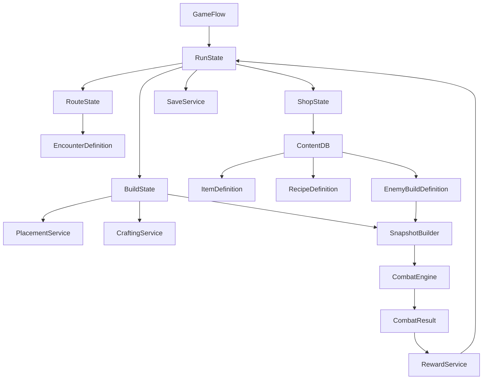

# PvE 背包构筑 Roguelite 完整规划

> 文档状态：产品与系统规划基线 v1.0，D01～D14 已冻结  
> 决策冻结日期：2026-10-12  
> 目标平台：Steam / Windows 优先  
> 固定引擎：Godot 4.7  
> 目标团队：学生团队，使用 AI 辅助开发  

## 1. 文档目的

本文档定义游戏首发版本的产品范围、核心玩法、完整功能系统、系统流转、内容规模、技术边界、制作阶段与验收标准。后续的技术架构、数据表、UI 原型、数值设计、任务拆分和测试计划，都应以本文档为上层约束。

本文档首先解决以下问题：

1. 游戏最重要的体验是什么。
2. 一局游戏从开始到结束如何流转。
3. 背包、商店、合成、战斗和 PvE 遭遇如何互相影响。
4. 哪些功能是 Steam 首发必须完成的，哪些明确不做。
5. 学生团队如何在 AI 辅助下控制代码和内容复杂度。
6. 如何建立清晰、可测试且适合学生团队协作的技术边界。

术语约定：`Run` 指从选择角色到通关或失败结束的一次完整单局冒险；`Tooltip` 指物品、状态或规则的悬停/详情提示面板；“背包层”只负责提供有效格和空间规则，“内容层”用于放置参与构筑与战斗的普通物品。

## 2. 产品定义

### 2.1 一句话定位

一款以异形背包空间构筑和商店经济决策为核心的单机 PvE 自动战斗 Roguelite。玩家购买、旋转、排列和合成物品，在有限空间内形成触发链与流派，并针对逐步增强的敌人调整构筑，最终击败章节 Boss。

### 2.2 核心体验

玩家的主要乐趣不是实时操作，而是：

- 在有限金币下判断应该购买、刷新、锁定还是储蓄。
- 在有限空间内解决形状、方向、邻接、作用范围和合成冲突。
- 看见重新布局后，原本普通的物品形成高效触发链。
- 根据下一场敌人情报临时改变布局或购买针对性组件。
- 在随机商店和路线条件下，逐步将不完整构筑发展成明确流派。
- 通过自动战斗验证此前的经济和空间决策。

### 2.3 目标玩家

- 喜欢构筑、自动战斗、Roguelite 和资源管理的玩家。
- 喜欢研究协同、配方和最优布局，但不要求高强度即时操作的玩家。
- 单局可投入 30～45 分钟，希望失败后快速重开的玩家。

### 2.4 首发目标

- 形成完整、可重复游玩的单机 PvE 循环。
- 背包空间和商店经济拥有足够深度，能够支撑至少 6 种构筑流派。
- 两名角色具有明确差异，但共享大部分底层规则和公共物品池。
- 三章内容组成完整 Run，含普通战、精英、事件、商店、休息和 Boss。
- 支持键鼠和手柄、存档、本地化基础、Steam 成就与 Steam Cloud。
- 不依赖联网即可完整游玩。

### 2.5 明确不做

首发版本不包含：

- 实时 PvP 或异步玩家构筑匹配。
- 排位、Rating、联赛、赛季、奖杯和排行榜。
- 多人大厅、观战、复战和玩家构筑上传。
- UGC、创意工坊和模组编辑器。
- 战令、每日任务、皮肤商店和复杂账号系统。
- 子职业商店、独立技能商店和大型技能树。
- 宝石插槽、多层催化剂与三层以上合成链。
- 动态市场、商人声望和复杂永久养成。
- 程序化生成任意敌人构筑作为首发必需功能。

## 3. 设计支柱

### 3.1 空间就是资源

物品强度不能只由价格和稀有度决定。形状、占格、方向、背包类型、邻接要求和作用范围都构成成本。强力物品可能难以摆放，便宜小物品可能是完善触发链的关键组件。

### 3.2 商店选择必须有机会成本

每次购买都会消耗金币和空间；每次刷新都会消耗继续搜索的预算；锁定商品会占用未来商店槽；储蓄能够产生有限收益，但不能成为唯一正确策略。

### 3.3 战斗是构筑验证器

自动战斗负责清晰展示构筑结果，而不是用大量随机性掩盖决策。战斗日志、触发动画、伤害统计和敌人情报必须帮助玩家理解胜负原因。

### 3.4 PvE 提供针对性决策

下一场敌人的关键倾向应提前展示。玩家不仅要追求自己的流派，还要决定是否为穿甲、净化、爆发、生存或续航腾出临时空间。

### 3.5 深度来自组合，不来自规则数量

使用有限的触发器、效果、状态和作用范围模板，通过组合产生内容。避免为每件物品编写独立复杂逻辑，避免依赖大量例外规则制造“深度”。

## 4. 游戏整体流程

### 4.1 产品级流程

```text
启动游戏
  ↓
主菜单
  ├─ 继续游戏
  ├─ 开始新游戏
  ├─ 图鉴
  ├─ 设置
  └─ 制作人员
        ↓
角色选择
        ↓
难度选择
        ↓
初始物品与初始背包
        ↓
章节开始
        ↓
路线节点选择
        ↓
商店/整理阶段
        ↓
战斗或事件
        ↓
战后奖励
        ↓
下一个节点
        ↓
章节 Boss
        ↓
下一章节
        ↓
最终 Boss
        ↓
Run 结算与难度解锁
```

### 4.2 单节点循环

```text
显示下一场敌人情报
  ↓
进入商店
  ├─ 购买
  ├─ 出售
  ├─ 刷新
  ├─ 锁定
  ├─ 调整背包
  ├─ 仓库交换
  └─ 查看配方与属性预测
        ↓
确认出战
        ↓
锁定本场构筑快照
        ↓
准备双方角色与物品
        ↓
自动战斗
        ↓
胜利/失败结算
        ↓
金币、物品或功能性奖励
        ↓
保存 Run 状态
```

### 4.3 Run 结构

首发采用三章制，每章约 4 个常规路线节点（包含战斗与非战斗节点）加 1 个 Boss 节点：

| 章节 | 推荐节点 | 战斗压力 | 商店稀有度 | 核心目的 |
|---|---:|---|---|---|
| 第一章 | 4 + Boss | 低 | 普通为主 | 建立构筑方向，认识规则 |
| 第二章 | 4 + Boss | 中 | 稀有增加 | 完成核心协同，应对反制 |
| 第三章 | 4 + Boss | 高 | 稀有与传奇 | 优化布局，完成终局构筑 |

单局预计 12～15 场战斗，30～45 分钟。节点数量不是固定必须值，可以根据测试结果调整，但首发不应超过 18 场战斗。

### 4.4 路线选择

不制作复杂可拖动的大地图。每次提供 2～3 个候选节点：

- 普通战：标准风险和标准奖励。
- 危险战：敌人带一个词缀，奖励品质提升。
- 精英战：更完整的敌人构筑，提供稀有奖励。
- 商店：额外商店，不发生战斗。
- 休息：恢复生命，或按已有配方升级一件物品。
- 事件：提供金币、交换、生命代价、物品或临时经济效果。
- Boss：章节终点，必须完成。

路线选择界面只显示节点类型、敌人标签、奖励倾向和已知风险，不显示精确掉落。

## 5. 游戏状态机

### 5.1 顶层状态

```text
BOOT
  ↓
MAIN_MENU
  ↓
RUN_SETUP
  ↓
ROUTE_SELECT
  ↓
SHOP_PREPARE
  ↓
COMBAT_PREPARE
  ↓
COMBAT_RUNNING
  ↓
COMBAT_RESULT
  ↓
REWARD_SELECT
  ↓
ROUTE_SELECT / ACT_RESULT / RUN_RESULT
```

### 5.2 状态职责

| 状态 | 允许操作 | 离开条件 |
|---|---|---|
| `RUN_SETUP` | 选角色、选难度、确认初始配置 | 创建 RunState |
| `ROUTE_SELECT` | 查看并选择下一节点 | 选中合法节点 |
| `SHOP_PREPARE` | 买卖、刷新、锁定、布局、仓库交换 | 点击确认出战或离开节点 |
| `COMBAT_PREPARE` | 构建快照、校验布局、初始化 RNG | 双方准备完成 |
| `COMBAT_RUNNING` | 调速、暂停、查看详情 | 一方死亡或超时 |
| `COMBAT_RESULT` | 查看统计和胜负原因 | 确认结果 |
| `REWARD_SELECT` | 选择奖励、处理满背包 | 奖励处理完成 |
| `ACT_RESULT` | 章节总结、Boss 奖励 | 进入下一章 |
| `RUN_RESULT` | 总结、解锁、统计 | 返回主菜单或重新开始 |

任何状态只能通过统一 `GameFlow` 请求切换，UI 不得直接切换场景并修改 Run 数据。

## 6. 胜负与资源规则

### 6.1 Run 生命规则

首发固定采用“角色生命持续制”：

- 玩家拥有跨战斗持续的当前生命值。
- 战斗胜利后保留剩余生命。
- 战斗失败时 Run 直接结束。
- 普通战后恢复少量生命，休息节点可恢复更多。
- Boss 战前不自动回满。

这样能够让治疗、恢复、风险路线和商店购买产生跨节点价值。

首发不采用多次失败机会。若测试显示持续生命过于严苛，应优先调整战后恢复、休息收益、敌人强度和路线奖励，不改变 Run 的基本失败结构。

### 6.2 战斗胜利

- 敌方生命降到 0，玩家胜利。
- 玩家生命降到 0，Run 失败。
- 达到战斗时间上限后进入疲劳阶段，双方持续受到递增伤害，直到分出胜负。
- 不设计平局。

### 6.3 核心资源

| 资源 | 用途 | 是否跨战斗 |
|---|---|---|
| 当前生命 | Run 生存状态 | 是 |
| 金币 | 购买、刷新和部分事件 | 是 |
| 背包有效格 | 放置物品 | 是 |
| 仓库格 | 保存临时或针对性物品 | 是 |
| 商店槽 | 当前购买机会，被锁定商品占用 | 单商店/可跨一节点 |
| 物品冷却 | 控制战斗触发频率 | 否 |
| 耐力 | 武器与部分主动物品消耗 | 否 |
| 战斗效果 | 护甲、毒、灼烧等 | 否 |

## 7. 角色与流派系统

### 7.1 角色设计原则

首发只制作 2 名角色。角色差异来自初始规则、专属物品池和擅长标签，不增加独立技能树、职业商店或角色等级。两名角色共享商店、背包、合成、战斗和状态系统，避免形成两套代码。

每名角色只包含以下差异项：

- 1 个常驻角色被动。
- 2 套初始装备组合，开始 Run 时二选一。
- 10～15 件角色专属物品。
- 3 种推荐流派，其中至少 1 种能与另一角色共享公共物品。
- 1 套角色主题视觉、音效和战斗反馈。

角色被动必须能够使用通用效果描述，不允许直接在角色脚本中堆叠大量物品名称判断。

### 7.2 首发角色建议

角色名称均为功能代号，正式名称在美术与世界观阶段重新确定。

| 角色 | 战斗定位 | 角色被动建议 | 专属标签 | 主要流派 |
|---|---|---|---|---|
| 武备师 | 稳定攻击、护甲、耐力管理 | 每有一种不同的武器形状，首次攻击获得小额强化；上限 3 次 | 武器、护甲、磨砺 | 连击武器、护甲反击、重击蓄力 |
| 调配师 | 状态叠加、恢复、冷却联动 | 每场首次施加一种新的负面状态时，恢复少量生命或获得加速；上限 3 种 | 药剂、草药、火焰 | 毒素累积、灼烧节奏、治疗转化 |

角色被动应是“推动布局与购买选择”的规则，不能直接替代物品构筑。被动的预期贡献为整场输出或生存能力的 8%～15%。

### 7.3 六种核心流派

| 流派 | 核心资源 | 空间难题 | 商店决策 | 克制关系 |
|---|---|---|---|---|
| 连击武器 | 耐力、攻击速度 | 多件小武器需要共享增益范围 | 追求低价武器和耐力组件 | 怕高护甲和疲劳战 |
| 重击蓄力 | 单次伤害、暴击 | 大型异形武器难摆放 | 是否为高价核心件储蓄 | 克制恢复，怕护甲、减速或被抢先击败 |
| 护甲反击 | 护甲、受击触发 | 防具需包围反击核心 | 防守组件与伤害组件的比例 | 克制连击，怕毒与灼烧 |
| 毒素累积 | 毒层数、持续时间 | 药材需要相邻或处于作用区 | 搜索启动件还是补稳定组件 | 克制护甲，怕净化与爆发 |
| 灼烧节奏 | 灼烧、冷却缩减 | 热源会强化特定方向物品 | 高速低价件与稀有热源取舍 | 克制慢速构筑，怕治疗与净化 |
| 治疗转化 | 治疗、吸血、溢出收益 | 治疗源与转化器争夺中心格 | 续航与终结能力平衡 | 克制消耗战，怕高爆发 |

流派是标签和协同的组合，不是强制职业。玩家可以形成混合构筑，但一件物品最多承担一个主要机制和一个辅助机制，避免文本和结算爆炸。

### 7.4 构筑成长阶段

1. 第一章前半：购买通用效率物品，解决空间与生存底线。
2. 第一章后半：获得第一件流派启动件，确定主要标签。
3. 第二章：补充触发器、资源供给和针对性组件，完成一阶合成。
4. 第三章：替换低效率组件，完成少量二阶合成并针对 Boss 调整。

游戏不保证每局获得指定传奇物品。任何流派都必须存在普通品质启动方式，稀有和传奇物品负责改变效率或玩法，而不是决定流派能否运行。

## 8. 背包空间系统完整规格

### 8.1 系统目标

背包是本作最重要的操作界面。它同时承载以下决策：

- 可用空间从哪里获得。
- 异形物品是否能够完整放入有效格。
- 物品朝向如何改变作用范围。
- 哪些物品应占据稀有的星位或背包加成格。
- 邻接、同行、同列和负向条件是否满足。
- 是否应拆散现有组合，为更高价值组合腾出空间。

### 8.2 双层网格模型

背包编辑区采用固定逻辑画布，建议为 `9 × 7` 格。画布分为两个逻辑层：

1. **背包层**：只放置背包物品。背包物品的形状决定哪些格成为有效格。
2. **内容层**：放置武器、护甲、药剂和材料等普通物品。普通物品的每个占用格都必须被背包层提供的有效格覆盖。

简化约束：

- 背包物品之间不得重叠。
- 普通物品之间不得重叠。
- 普通物品可以覆盖在背包提供的有效格之上，这是双层模型的正常行为。
- 不允许背包套背包、物品堆叠、半格或自由角度旋转。
- 所有旋转均为 90 度倍数。
- 同一有效格只能归属于一个背包，避免加成归属歧义。

### 8.3 形状定义

每个可放置对象使用局部坐标掩码描述形状：

```text
shape_cells = [(0,0), (1,0), (0,1)]
origin = (0,0)
rotation = 0 / 90 / 180 / 270
```

旋转后先将坐标归一化到左上角，再执行边界和碰撞检测。美术贴图不得参与逻辑碰撞，逻辑形状和视觉边界必须分离。

首发建议只使用 1～6 格物品，常见模板包括：

- 单格、横向两格、纵向两格。
- `L` 形三格、直线三格、`T` 形四格。
- `2 × 2` 方形、折线四格。
- 少量五格或六格终局物品。

### 8.4 背包物品

背包本身作为商店商品出现，占据背包层并提供有效格。每个背包定义：

- 形状与有效格坐标。
- 价格、稀有度和出现章节。
- 0～2 个特殊格。
- 可选的包内被动。
- 标签偏好，例如武器、药剂或护甲。

首发制作 8～10 种背包，其中：

- 3 种纯空间背包：便宜、规则简单。
- 3～4 种标签背包：对指定类型提供小幅加成。
- 2～3 种结构背包：形状特殊，提供方向或星位能力。

背包加成应小于核心物品本体强度。玩家购买背包首先是购买空间，其次才是购买增益。

### 8.5 特殊格与星位

特殊格由背包物品定义，首发只保留两类：

| 类型 | 规则 | 表现 |
|---|---|---|
| 强化格 | 覆盖该格的物品获得固定小幅加成 | 格子边框与物品描边同时高亮 |
| 星位 | 作为部分物品的作用目标或触发条件 | 星形标记，悬停时显示连线 |

如果多格物品覆盖多个特殊格，同类效果默认只计算一次，除非数据字段明确声明可叠加。首发不增加颜色格、元素格、插槽格等更多格子类型。

### 8.6 空间关系模板

所有空间效果只能选择以下标准模板，禁止每件物品自创几何判断：

| 模板 | 含义 |
|---|---|
| 四向相邻 | 与物品任一占用格上下左右接触 |
| 八向相邻 | 包含斜角接触 |
| 前方 | 根据物品朝向投射固定长度 1～3 格 |
| 同行 | 与物品中心处于同一逻辑行 |
| 同列 | 与物品中心处于同一逻辑列 |
| 星位 | 作用于指定星位上或与星位相邻的物品 |
| 包内 | 作用于同一背包提供格内的物品 |
| 同标签全局 | 作用于构筑内满足标签的所有物品 |

同行、同列和全局效果应较弱，方向性和邻接效果可更强，因为其空间成本更高。

### 8.7 正向与负向空间条件

物品可以有正向条件，也可有少量负向条件：

- 正向示例：前方每有一件武器，伤害提高。
- 正向示例：与两种不同标签相邻时，冷却缩短。
- 负向示例：如果与其他武器相邻，攻击速度降低。
- 负向示例：作用范围内存在药剂时，无法获得暴击加成。

限制规则：

- 负向条件只用于约 10%～15% 的物品。
- 单件物品最多 1 条负向条件。
- 负向条件必须能在整理界面实时显示是否满足。
- 不设计需要记忆战斗历史的空间条件。

### 8.8 放置校验顺序

```text
读取物品旋转后的 shape_cells
  ↓
转换为全局网格坐标
  ↓
检查是否超出画布
  ↓
检查同层碰撞
  ↓
普通物品检查每格是否为有效格
  ↓
检查背包出售后是否导致物品悬空
  ↓
生成空间关系缓存
  ↓
刷新加成预览、配方提示和出战合法性
```

所有校验由 `PlacementService` 提供纯数据接口。拖拽 UI 只提交候选位置，不直接修改最终状态。

### 8.9 编辑操作

必须支持：

- 拖拽放置与交换。
- 鼠标滚轮或按键旋转。
- 一键送入仓库。
- 从仓库拖回背包。
- 悬停显示占格、作用格和受影响物品。
- 非法位置红色预览，合法位置绿色预览。
- 最近至少 20 步撤销/重做，仅限当前整理阶段。
- 一键整理只做紧凑排列建议，不自动优化构筑。

出战前必须完成一次完整合法性检查。存在悬空、重叠或未处理奖励时，“开始战斗”按钮不可用并显示具体原因。

### 8.10 性能与可测试性

背包画布规模很小，不需要复杂物理碰撞。所有逻辑使用整数坐标和集合运算。任何时刻应能够从 `BuildState` 重新计算：

- 有效格集合。
- 每个物品占用格。
- 每个物品的邻接和作用目标。
- 背包归属与特殊格覆盖。
- 当前可合成配方。

这些派生数据不作为唯一存档真相，避免版本升级后出现脏缓存。

## 9. 商店与经济系统完整规格

### 9.1 商店目标

商店必须让玩家在“立即变强、继续寻找、保留机会、购买空间和积累利息”之间权衡。商店不只负责随机发牌，也要为构筑纠偏，防止玩家因连续坏运气完全失去决策空间。

### 9.2 标准商店结构

- 固定 5 个商品槽。
- 每个商店恰好 1 个促销位，折扣建议 25%，最低价格 1 金币。
- 最多锁定 2 个商品；锁定商品进入下一次标准商店并占据对应槽位。
- 锁定免费，但锁定槽位不会参与下一次新商品生成。
- 商人节点可以额外提供一次免费刷新或第 6 个临时槽位，二选一实现即可。
- 商品可以是普通物品或背包物品；不单设背包商店。

### 9.3 刷新费用

每个商店独立计算刷新次数，初始建议：

| 当前商店刷新次数 | 第 1～2 次 | 第 3～4 次 | 第 5 次起 |
|---|---:|---:|---:|
| 每次费用 | 1 | 2 | 3 |

进入下一商店后刷新费用重置。锁定商品不会被刷新，未锁定槽重新生成。刷新前显示本次费用，金币不足时禁用按钮。

### 9.4 商品生成流程

```text
确定章节与节点等级
  ↓
读取章节稀有度权重
  ↓
为每个未锁定槽选择商品池来源
  ↓
应用角色、流派倾向和去重复权重
  ↓
执行背包保底与最低可用性检查
  ↓
生成具体商品 ID
  ↓
选择一个未锁定槽作为促销位
  ↓
记录本商店生成结果和 RNG 状态
```

初始商品池来源权重：

| 来源 | 权重 | 说明 |
|---|---:|---|
| 公共池 | 60% | 基础武器、防具、经济与通用辅助件 |
| 角色池 | 25% | 当前角色专属物品 |
| 流派倾向池 | 15% | 根据背包内主要标签动态提高相关物品出现率 |

流派倾向只做轻微纠偏，不直接保证核心物品。计算主要标签时忽略仓库，并对单一标签权重设置上限，避免商店越来越单一。

### 9.5 稀有度曲线

初始建议：

| 章节 | 普通 | 稀有 | 传奇 |
|---|---:|---:|---:|
| 第一章 | 80% | 20% | 0% |
| 第二章 | 55% | 40% | 5% |
| 第三章 | 35% | 50% | 15% |

精英战后的奖励商店可将一次生成向上提升一个品质档，但不直接保证传奇。Boss 奖励从独立的 Boss 奖励池生成。

### 9.6 背包保底

如果连续 3 个标准商店都没有出现任何背包商品，则下一个标准商店至少生成 1 个当前可出现的背包。规则只保证“出现”，不保证价格或形状最优。

以下情况重置计数：

- 商店自然生成背包。
- 保底生成背包。

购买与否不影响计数。商人节点和奖励选择不计入连续标准商店数量。

### 9.7 金币收入与储蓄收益

初始建议：

- Run 初始金币：8。
- 普通战基础收入：第一章 5、第二章 6、第三章 7。
- 精英战额外收入：2。
- Boss 战不发普通金币，改为 Boss 奖励。
- 每 5 枚结余金币获得 1 枚利息，上限 2 枚。
- 利息在战斗胜利结算时计算，事件奖励金币不重复触发利息。

利息上限较低，目的是让储蓄成为可选策略，而不是强迫所有玩家长期囤钱。

### 9.8 价格与出售

价格由物品数据直接定义，不用“格数 × 稀有度”的公式自动决定，但内容设计应落在以下区间：

| 类型 | 建议价格 |
|---|---:|
| 普通小件 | 2～4 |
| 普通核心件 | 4～6 |
| 稀有物品 | 6～9 |
| 传奇物品 | 10～14 |
| 背包 | 3～8 |

出售规则：

- 在当前整理阶段刚购买、尚未进入战斗的商品可原价退回，防止误操作。
- 已参加过战斗的物品按基础价格的 50% 向下取整出售，最低 1 金币。
- 合成物出售价格由成品数据定义，不简单等于材料总价。
- 背包只有在移除后不会导致任何普通物品悬空时才能出售。
- 促销不降低后续出售基准，避免折扣套利。

### 9.9 商店锁定与跨节点状态

锁定状态只跨越一次节点。如果玩家在下一商店仍不购买，可再次锁定。进入 Boss 奖励、事件或章节切换不会吞掉锁定商品；它们在下一个标准商店恢复。

存档中必须记录锁定商品的 `item_def_id`、实例属性、原价、促销状态和锁定剩余次数。不能只保存商店 RNG 种子后重新生成，以免版本更新导致内容变化。

### 9.10 经济健康目标

平衡阶段应满足：

- 玩家每个标准商店平均能购买 1～2 件普通物品，或为一件高价物品储蓄。
- 连续 2 个商店完全无可执行购买决策的概率低于 5%。
- 平均每局刷新 8～15 次，但高刷新策略不能稳定优于储蓄与购买空间。
- 第一章结束时平均拥有 12～16 个有效格；第三章结束时 20～26 个有效格。
- 玩家在最终 Boss 前应能完成 2～4 个一阶合成和 0～2 个二阶合成。

## 10. 物品数据、标签、稀有度、触发器和效果

### 10.1 数据驱动原则

物品定义使用 Godot `Resource`，运行时状态使用轻量实例对象。大多数物品由触发器、条件、目标选择和效果组合完成，不为每件物品创建独立脚本。

建议的核心定义：

```text
ItemDefinition
├─ id / display_name_key / description_key
├─ rarity / base_price / chapter_min
├─ tags[]
├─ shape_cells[] / allowed_rotations[]
├─ cooldown / stamina_cost
├─ spatial_rules[]
├─ trigger_specs[]
├─ effect_specs[]
├─ recipe_refs[]
└─ presentation_refs
```

运行时 `ItemInstance` 只保存：

- 唯一实例 ID。
- `item_def_id`。
- 所在层、原点坐标和旋转。
- 当前战斗冷却、次数和临时修正。
- 购买节点、是否参加过战斗等经济标记。

### 10.2 稀有度

首发仅使用三档：

| 稀有度 | 设计职责 | 复杂度上限 |
|---|---|---|
| 普通 | 基础资源、稳定触发、流派启动 | 1 个主要效果 |
| 稀有 | 连接两个机制或改变空间价值 | 1 个主要效果 + 1 个条件 |
| 传奇 | 改变构筑方向或形成终局核心 | 最多 2 个相互关联效果 |

稀有度不代表纯数值碾压。传奇物品通常价格高、形状难放或需要特定构筑支持。

### 10.3 标签体系

标签用于目标筛选、商店倾向、配方和 UI 检索。首发控制在 12～16 个：

- 类型标签：武器、护甲、药剂、食物、材料、工具、饰品、背包。
- 机制标签：毒、火焰、治疗、耐力、暴击、反击、经济、冷却。
- 归属标签：公共、武备师、调配师。

每件物品建议拥有 2～4 个标签。新增标签前必须确认至少有 4 件物品或 1 个完整系统会使用它。

### 10.4 标准触发器

首发支持以下触发器：

- 战斗开始。
- 自身冷却完成。
- 自身攻击命中。
- 自身造成暴击。
- 自身或作用目标激活后。
- 玩家受到伤害后。
- 获得护甲后。
- 施加指定状态后。
- 生命首次低于指定百分比。
- 每经过固定秒数。
- 战斗进入疲劳阶段。

单件物品最多配置 2 种触发器。高频触发器必须带冷却、次数上限或每事件限制。

### 10.5 标准条件

- 自身或目标具有指定标签。
- 满足指定邻接/方向模板。
- 当前生命高于或低于阈值。
- 当前护甲、耐力或状态层数达到阈值。
- 本场已触发次数低于上限。
- 构筑中指定标签数量达到阈值。
- 敌人具有指定状态。

条件组合首发只支持 `全部满足`，不实现可视化逻辑表达式树。需要“任一满足”的内容拆成多个效果条目。

### 10.6 标准效果

- 造成物理伤害或固定真实伤害。
- 获得护甲。
- 恢复生命。
- 恢复或消耗耐力。
- 施加、移除或转化状态层数。
- 修改本场冷却、伤害、暴击率或状态强度。
- 立即推进某个作用目标的冷却，设有每事件上限。
- 在战斗开始时按空间条件生成一次性增益。

首发不支持召唤物实体、弹道碰撞、复杂位置移动、复制任意物品文本或永久改变物品定义。

### 10.7 数值修正顺序

统一采用：

```text
基础值
  → 固定加法
  → 百分比加法合计
  → 百分比乘法修正
  → 最小/最大值限制
  → 最终取整
```

冷却最短建议不低于 `0.5 秒`；暴击率上限 `75%`；减伤上限 `70%`。所有上限必须在 Tooltip 中可查询。

### 10.8 文本生成与 Tooltip

物品描述优先由结构化数据和本地化模板生成，以减少规则文本和真实结算不一致。Tooltip 分为三层：

1. 默认：名称、价格、主要效果、冷却、耐力消耗。
2. 展开：当前布局下的最终数值和已连接目标。
3. 高级：触发顺序、状态定义、数值上限和配方来源。

动态数值用统一颜色和图标标识。不能只靠颜色表达合法、增强或减益状态。

## 11. 合成与配方系统

### 11.1 设计目标

合成用于给中后期构筑提供空间压缩和能力升级，但不应迫使玩家背诵庞大配方表。首发只制作 20～25 个配方，并限制为最多两级。

### 11.2 配方类型

| 类型 | 示例结构 | 数量建议 |
|---|---|---:|
| 同物升级 | `A + A → A+` | 8～10 |
| 跨类组合 | `A + B → C` | 8～10 |
| 角色专属 | `公共材料 + 专属核心 → C` | 每角色 2～3 |

二阶成品不能继续参与更多合成。首发不做三材料配方、随机结果配方或需要战斗外货币的配方。

### 11.3 发现与执行

材料物品满足配方空间要求时，显示合成预览连线。合成不会立即自动发生，玩家必须点击“合成”或使用确认键，避免误吞关键物品。

执行流程：

```text
检测满足条件的材料集合
  ↓
按配方优先级去除歧义
  ↓
显示成品形状、属性和放置预览
  ↓
玩家确认
  ↓
再次校验材料和目标空间
  ↓
移除材料并创建成品实例
  ↓
若成品无法合法放置，则进入手持状态等待摆放
  ↓
记录图鉴发现并支持本阶段撤销
```

### 11.4 配方空间条件

首发只允许：

- 四向相邻。
- 位于同一背包内。
- 至少一个材料位于星位。

多数配方只要求四向相邻。方向和星位配方总数不超过 5 个，以免配方查找成为主要负担。

### 11.5 配方提示

- 已拥有一个材料时，在另一个材料 Tooltip 中显示“可与已拥有物品合成”。
- 商店商品可预览它与当前构筑能形成的已知配方。
- 未发现配方在图鉴中显示轮廓和材料类别，不直接显示完整答案。
- 玩家首次把正确材料相邻放置时，即使配方未发现，也显示明确确认提示。

## 12. 仓库系统

### 12.1 规则

- 初始 2 个仓库槽，Run 中最多提升到 4 个。
- 每个仓库槽可存放 1 件普通物品，不考虑物品形状。
- 背包物品也可入库，但其提供的有效格立即失效；必须先处理悬空物品。
- 仓库物品不提供战斗效果、不参与标签计数、不触发空间关系和合成。
- 战斗开始前仓库可以有物品，无需清空。
- 战后奖励在背包和仓库均满时进入“待处理区”，玩家必须出售、替换或放弃后才能继续。

### 12.2 扩容方式

仓库扩容只通过固定章节奖励或少量事件获得，不作为普通商店商品反复出现。建议第二章开始时固定奖励第 3 格，第三章开始时固定奖励第 4 格；难度模式可延后其中一次扩容。章节固定扩容不占用 Boss 三选一奖励槽；如果事件提前授予了对应容量，章节奖励改为等价金币或恢复补偿。

### 12.3 设计作用

仓库主要服务三种决策：

- 暂存尚未凑齐配方的材料。
- 保存针对特定 Boss 的净化或无视护甲伤害组件。
- 在流派转换时保留旧核心，降低试错成本。

仓库不能扩大到能够囤积整个备用构筑，否则会削弱背包空间与出售决策。

## 13. 自动战斗系统

### 13.1 战斗目标

战斗必须快速、可理解、可复现。玩家不能在战斗中移动物品或释放主动技能，只允许暂停、调速、查看 Tooltip 和统计。

建议单场时长：

- 普通战：30～60 秒。
- 精英战：45～75 秒。
- Boss 战：60～90 秒。
- 超过 90 秒必须进入明显的疲劳收束。

### 13.2 核心属性

| 属性 | 作用 |
|---|---|
| 最大生命 | 战斗与 Run 的生存上限 |
| 当前生命 | 跨战斗保留 |
| 护甲 | 优先吸收物理伤害，战斗结束清空 |
| 耐力上限 | 武器可使用的资源池 |
| 耐力恢复 | 每秒恢复量 |
| 伤害修正 | 对物理伤害的统一修正 |
| 状态强度 | 对毒、灼烧、治疗等数值的修正 |
| 暴击率 | 物理攻击产生暴击的概率 |
| 暴击倍率 | 默认建议 1.5 倍 |
| 速度修正 | 影响物品冷却，不影响动画时间轴 |

不加入命中、闪避、元素抗性、护甲穿透率等更多常驻属性。需要克制护甲时使用固定“忽略护甲伤害”或状态效果，降低公式数量。

### 13.3 战斗初始化

```text
读取玩家 BuildSnapshot 和 EnemySnapshot
  ↓
验证内容版本和布局合法性
  ↓
用 combat_seed 初始化确定性 RNG
  ↓
创建双方 CharacterRuntime 与 ItemRuntime
  ↓
重新计算空间关系和战斗初始修正
  ↓
按稳定顺序执行“战斗开始”触发器
  ↓
启动固定步长战斗时钟
```

稳定顺序建议为：角色被动 → 背包效果 → 普通物品，物品之间按背包坐标从上到下、从左到右，再按实例 ID 排序。

### 13.4 固定步长与事件队列

逻辑以固定步长运行，建议 `0.05 秒`。表现层可使用插值，不允许帧率改变结算结果。

每次逻辑步：

1. 推进战斗时间和冷却。
2. 生成已到期的主动触发事件。
3. 按时间、优先级、阵营、实例 ID 对事件排序。
4. 逐个结算事件及其派生事件。
5. 检查死亡与疲劳条件。
6. 将结果事件发送给表现层。

### 13.5 单次攻击结算

```text
检查攻击者存活、冷却和耐力
  ↓
扣除耐力并锁定本次基础伤害
  ↓
执行攻击前修正
  ↓
使用确定性 RNG 判断暴击
  ↓
计算护甲吸收与生命伤害
  ↓
应用吸血或命中附加状态
  ↓
派发命中、受伤、暴击等事件
  ↓
执行触发链
  ↓
进入新的冷却周期
```

如果耐力不足，物品进入短暂等待而不是重置完整冷却。建议每 `0.2 秒` 重新检查一次，避免高速武器因资源不足完全失去响应。

### 13.6 伤害与治疗

- 物理伤害先扣护甲，再扣生命。
- 真实伤害直接扣生命，只允许少量物品和疲劳使用。
- 治疗不能超过最大生命，溢出默认丢失；治疗转化流派可通过明确物品利用溢出值。
- 吸血按实际造成的生命伤害计算，不按被护甲吸收前数值计算。
- 同一事件中的伤害先完整结算，再检查受击触发，避免结算中途改变本次伤害。

### 13.7 战斗效果与状态

首发建议保留 8 类常见战斗效果。护甲是战斗资源，净化是即时效果，其余项目是持续状态；只有持续状态使用统一的层数、持续或衰减规则：

| 状态 | 规则建议 |
|---|---|
| 护甲 | 战斗资源；吸收物理伤害，战斗结束清空，不作为状态层数处理 |
| 毒 | 每 1 秒造成等于当前层数的伤害，然后减少 1 层 |
| 灼烧 | 每 0.5 秒造成部分层数伤害，每次触发减少固定比例或 1 层 |
| 减速 | 降低目标物品冷却推进速度，设总上限 |
| 再生 | 每 1 秒恢复生命，然后减少 1 层 |
| 吸血 | 作为限时增益，提高伤害转治疗比例 |
| 易伤 | 提高受到的生命伤害，设层数上限 |
| 净化 | 不是持续层数；一次移除指定数量的负面状态层 |

暴击是攻击属性，不作为状态层数。持续状态图标必须显示当前层数、下一次跳动时间和上限；护甲单独显示当前数值，净化只显示本次结算反馈。

### 13.8 触发链限制

- 单个根事件的最大派生深度为 8。
- 同一物品在同一根事件中默认最多激活 1 次。
- 同一作用目标被“立即推进冷却”的总量设上限。
- 超过限制的事件记录为 `CHAIN_LIMIT_REACHED`，不再继续派生。
- 内容验证器应静态检测明显的无冷却循环。

触发链限制属于核心规则，必须在高级 Tooltip 和图鉴帮助中公开。

### 13.9 同时死亡与疲劳

- 每个原子事件结算后检查死亡。
- 同一原子事件导致双方同时死亡时，玩家判负，防止通过自毁绕过 Boss。
- 达到时间上限后进入疲劳：每 2 秒双方受到递增真实伤害，并降低治疗效果。
- 疲劳伤害不触发受击类物品，避免再次延长战斗。

### 13.10 确定性 RNG

每场战斗的所有随机结果来自 `combat_seed` 和确定的调用顺序。禁止物品直接调用全局随机函数。随机接口必须包含用途域，例如：

```text
CombatRng.roll("critical", source_instance_id)
CombatRng.roll("status_proc", source_instance_id)
```

相同快照、内容版本和种子必须产生相同胜负与最终数值。这是复现 Bug、平衡模拟和中途继续的基础。

### 13.11 战斗表现与统计

战斗界面支持 `1× / 2× / 4×`、暂停和逐项 Tooltip。结束后展示：

- 每件物品造成伤害、治疗、护甲和触发次数。
- 状态总施加量与最高层数。
- 耐力短缺时间。
- 玩家受到的主要伤害来源。
- 3 条以内的“胜负关键”自动摘要。

日志默认只展示关键事件，高级模式可展开完整事件流。完整日志应有容量上限，避免长战斗占用过多内存。

## 14. PvE 敌人、遭遇、精英与 Boss

### 14.1 敌人设计原则

敌人尽量使用与玩家相同的物品、空间和战斗规则。敌人不是实时 AI，不在战斗中做决策；它是一个经过验证的构筑快照加少量遭遇参数。

这带来三个好处：

- 玩家可以通过熟悉的物品理解敌人。
- 内容团队只需维护一套战斗规则。
- 敌人构筑可直接在开发用背包编辑器中制作和验证。

### 14.2 敌人构筑快照

每个敌人模板包含：

- 稳定 ID、显示名称和章节。
- 角色基础属性或怪物基础属性。
- 背包与普通物品布局。
- 物品实例等级或数值档位。
- 1～3 个威胁标签。
- 推荐强度分数区间。
- 可用章节、节点类型和难度范围。
- 可选的遭遇词缀。

敌人快照必须通过与玩家相同的布局验证器。首发不在运行时程序化拼装任意敌人背包，以控制平衡和调试成本。

### 14.3 普通敌人

首发制作 18～24 套普通敌人构筑，每章 6～8 套。每套构筑有 2～3 个数值档位或少量物品替换版本，用于不同节点深度，但核心玩法保持可识别。

普通敌人承担以下教学职责：

- 单一明显威胁，例如高频攻击、护甲、毒或治疗。
- 展示一个可被商店物品针对的弱点。
- 不同时拥有高爆发、高生存和强控制。

### 14.4 精英敌人

首发制作 6 套精英构筑，每章 2 套。精英拥有更完整的协同和一个明确词缀，奖励也更高。精英不简单使用普通敌人的数值翻倍。

精英设计要求：

- 至少提前一个节点展示完整情报。
- 必须有两种以上应对方式。
- 不要求玩家拥有某一件唯一物品才能获胜。
- 构筑强度高于同阶段普通战约 20%～30%。

### 14.5 Boss

首发共 3 个章节 Boss。每个 Boss 由以下部分组成：

- 固定主题构筑。
- 1 个 Boss 常驻规则。
- 最多 1 个生命阈值阶段变化。
- 2～3 个明确威胁和至少 1 个可利用弱点。

Boss 常驻规则示例：周期性强化最左侧物品、护甲破裂后进入狂暴、在玩家治疗时积累反制层。阶段变化只能修改已有规则参数或激活一个预告过的效果，不能突然引入全新系统。

### 14.6 遭遇词缀

首发最多 6 种，主要用于危险战和精英：

- 坚固：初始获得护甲。
- 迅捷：首次若干次冷却加快。
- 腐蚀：攻击附加少量毒。
- 炽热：周期性施加灼烧。
- 节制：双方治疗略微降低。
- 富矿：敌人略强，胜利额外获得金币或高品质奖励。

同一普通遭遇最多 1 个词缀，Boss 不使用随机词缀。词缀必须在路线选择时显示。

### 14.7 敌人情报

PvE 的核心优势是可针对性，因此默认公开敌人完整构筑：

- 路线选择界面显示威胁标签、词缀和奖励倾向。
- 进入商店后可随时打开敌人背包预览。
- 玩家可悬停敌人物品查看与自身相同格式的 Tooltip。
- UI 自动标出敌人的前三个主要伤害或生存来源。
- Boss 情报在章节开始时给出主题提示，Boss 前完整公开。

情报不显示随机战斗结果或系统给出的“必胜率”，避免替玩家做最终决策。

### 14.8 遭遇选取

选取时按章节、节点深度、难度和最近遇到记录过滤：

- 同一构筑不连续出现。
- 单个 Run 内同一普通敌人最多出现 2 次，且必须使用不同档位。
- 第一章前两个节点不出现强反制当前初始装备的敌人。
- 精英候选在进入章节时确定，防止通过重新载入改变结果。

### 14.9 强度预算

每件物品和敌人基础属性拥有内部强度分值，仅用于内容制作筛选，不直接显示给玩家。敌人构筑预算由章节和节点深度确定，然后通过批量模拟与人工试玩校准。

强度分不能替代测试。带有乘法协同、控制或触发链的构筑必须单独检查，不能只按物品价格相加。

## 15. 路线、奖励、事件与休息节点

### 15.1 路线结构

本作不制作复杂节点地图。每次节点完成后，从 2～3 张候选卡中选择下一节点。候选卡包含节点类型、敌人预览、词缀、主要奖励和风险等级。

每章建议结构：

```text
章节入口
  → 节点 1：普通战
  → 节点 2：2 选 1
  → 节点 3：2～3 选 1
  → 节点 4：普通/精英/休息
  → Boss
```

每个战斗节点都先进入一次标准战前整理商店。商人节点是额外的纯商店节点；如果路线选择后进入商人节点，玩家完成该节点便返回路线选择，不会立刻再进入一次标准战前商店。只有随后选定战斗节点时，才进入该战斗对应的标准战前商店。

### 15.2 路线生成约束

- 每章至少出现 1 次休息或事件候选。
- 第二、三章至少出现 1 次精英候选，但玩家可以选择绕开。
- 不同时向玩家提供 3 个功能完全相同的节点。
- 连续两个纯非战斗节点默认不允许。
- Boss 节点固定在章末，不参与随机。
- 候选结果在进入章节时按 `route_seed` 生成并保存，读档不重抽。

### 15.3 战后奖励

普通战胜利后获得基础金币，并从以下奖励中生成一项：

- 三选一普通物品，允许放弃换少量金币。
- 固定金币。
- 小额生命恢复。
- 下一商店一次免费刷新。

精英战奖励为三选一，至少包含一件稀有物品或功能奖励。Boss 奖励为三选一大型奖励，例如：

- 一件传奇或角色核心物品。
- 一个高价值背包。
- 提高最大生命并立即恢复一定生命。

奖励物品不直接塞入背包。玩家进入奖励处理界面，可以放入背包、仓库、出售或放弃。

### 15.4 休息节点

休息节点提供二选一：

- 恢复最大生命的 25%～35%。
- 免费将一件符合条件的一阶物品转化为其已定义的二阶配方结果，或获得一次指定商店折扣券。

休息升级复用 `RecipeDefinition` 与 `CraftingService`，不创建独立强化等级。为了控制复杂度，首发不加入锻造、移除诅咒、训练技能等更多休息功能。

### 15.5 事件系统

首发制作 10～14 个事件，每个事件只有 2～3 个选项，使用通用结果组件：

- 获得或失去金币。
- 恢复或损失当前生命。
- 从标签池中获得物品。
- 交换一件物品。
- 获得临时折扣、免费刷新或奖励品质提升。
- 进入带词缀的危险战并提高奖励。

事件不得包含永久独立属性树、隐藏连续任务或需要跨多个 Run 追踪的支线。每个选项必须预览确定结果或明确的概率范围。

### 15.6 节点结算顺序

```text
节点完成
  ↓
处理战斗结果与跨战斗生命
  ↓
发放金币和利息
  ↓
处理物品/功能奖励
  ↓
保存 RunState
  ↓
检查章节或 Run 是否结束
  ↓
生成并显示下一批路线候选
```

## 16. 难度与轻量长期系统

### 16.1 设计原则

长期目标用于给玩家新的挑战和记录，不通过永久数值养成降低难度。首发不制作元货币、基地、天赋树、每日任务或随机解锁池。

### 16.2 难度层级

建议提供：

| 难度 | 解锁条件 | 变化 |
|---|---|---|
| 教学 | 默认 | 敌人较弱，首次关键操作有引导，可重复游玩 |
| 标准 | 默认 | 设计基准体验 |
| 进阶 | 任意角色通关标准 | 敌人预算提高，治疗略降，商店容错略低 |
| 挑战 1～5 | 逐级通关 | 每级增加一个固定且公开的规则修正 |

挑战修正应固定、累积且全角色一致，例如：精英更强、休息恢复减少、第三章敌人多一个档位。不要制作随机词条组合式高难系统作为首发内容。

### 16.3 解锁内容

- 两名角色首发均可直接使用，便于学生测试和玩家选择。
- 图鉴条目随首次看到或合成解锁，不影响物品是否能在商店出现。
- 更高难度、角色结局插图、统计徽章和 Steam 成就通过游玩解锁。
- 不锁定关键流派物品，不要求重复刷取永久货币。

### 16.4 图鉴与记录

图鉴包括：

- 已见物品、完整数值与标签。
- 已发现配方和未发现配方轮廓。
- 已遇敌人、Boss 和词缀。
- 状态与规则词典。
- 每名角色的通关难度标记。

统计仅保存有明确价值的项目：Run 次数、通关次数、最高难度、常用物品、最高单次伤害、最长触发链和最快通关。首发不做在线排行榜。

### 16.5 每局变化来源

重复游玩主要依靠：

- 商店顺序和促销变化。
- 路线候选和事件变化。
- 敌人构筑顺序变化。
- 角色与初始装备组合。
- 6 种核心流派及混合构筑。
- 难度规则。

不依赖大量永久解锁来制造“内容逐步开放”的假深度。

## 17. UI 页面、界面流转、输入与无障碍

### 17.1 页面清单

| 页面 | 核心职责 |
|---|---|
| 启动与主菜单 | 继续、新游戏、图鉴、设置、退出 |
| 新游戏设置 | 角色、初始装备、难度、种子显示 |
| 路线选择 | 2～3 个候选节点与敌人/奖励情报 |
| 商店整理 | 商品、金币、背包、仓库、敌人预览、配方提示 |
| 事件 | 事件文本、2～3 个结果明确的选择 |
| 战斗 | 双方构筑、生命/护甲/状态、速度控制、事件表现 |
| 战斗结果 | 胜负、统计、关键原因、继续按钮 |
| 奖励选择 | 三选一、放置、出售或放弃 |
| 章节/Run 结算 | 路线总结、构筑快照、解锁和统计 |
| 图鉴 | 物品、配方、敌人、规则分类检索 |
| 设置 | 显示、音频、输入、语言和无障碍 |

### 17.2 商店整理页布局

桌面 16:9 推荐布局：

```text
┌ 顶栏：章节 / 节点 / 生命 / 金币 / 刷新费用 / 设置 ┐
├ 商品区 5 槽 ─────────────┬ 下一敌人情报与威胁 ┤
├ 背包编辑主区域 ──────────┤ 物品详情 / 关系预览 ┤
├ 仓库 2～4 槽 ────────────┴ 配方与构筑统计 ────┤
└ 撤销 / 重做 / 图鉴 / 开始战斗 ────────────────┘
```

背包区域必须拥有最大视觉面积。敌人情报可折叠，但开始战斗按钮附近持续显示主要威胁标签。

### 17.3 背包交互反馈

- 拿起物品时显示旋转后占格和所有可落点。
- 悬停物品时显示其作用范围、受益目标和来源连线。
- 按住“显示关系”键时，同时显示整个构筑的关键连接，普通连接降低透明度。
- 未满足条件显示灰色或断开的连线，并提供原因文本。
- 合成候选使用区别于普通协同的边框和图标。
- 物品最终数值发生变化时，在 Tooltip 中同时显示基础值和当前值。

### 17.4 键鼠输入

- 左键：选择、拖拽、确认。
- 右键：快速查看详情或取消手持。
- 滚轮 / `Q`、`E`：旋转物品。
- `F`：锁定或解锁当前商店商品。
- `R`：刷新商店。
- `Space`：开始战斗或战斗暂停。
- `Ctrl+Z` / `Ctrl+Y`：撤销与重做。
- `Tab`：切换背包、敌人情报和构筑统计焦点。

所有快捷键允许重绑定。快捷键提示根据当前输入设备动态变化。

### 17.5 手柄输入

- 使用逻辑网格光标导航背包，不模拟自由鼠标。
- `A/Cross` 拿起或放下，`B/Circle` 取消。
- 肩键旋转，扳机键切换页面区域。
- 方向键在网格中逐格移动；长按后加速重复。
- 可通过快捷键将当前物品送入仓库或锁定商品。
- 所有界面必须有明确初始焦点、循环顺序和返回路径。

Steam 发布前必须用 Xbox、PlayStation 风格控制器各完成至少一次全流程测试。

### 17.6 无障碍与可读性

- UI 缩放至少提供 80%、100%、120%、140%。
- 支持窗口、无边框窗口和全屏。
- 状态和稀有度不能只用颜色区分，同时使用图标、边框和文字。
- 提供色觉模式或高对比度状态图标。
- 提供减少闪烁、减少屏幕震动和降低战斗特效选项。
- 可独立调节音乐、环境、UI 和战斗音效。
- 战斗可暂停，Tooltip 在暂停时保持可读。
- 简体中文和英文首发文本均需经过 UI 溢出测试。

### 17.7 确认与防误操作

以下操作需要明确提示：

- 放弃未领取的稀有或传奇奖励。
- 出售会导致配方拆解或关键协同失效的物品。
- 开始战斗时存在空仓库不提示，但存在非法布局必须阻止。
- 返回主菜单时自动保存并说明保存点。
- 覆盖现有 Run 开始新游戏时需要确认。

## 18. 教程与信息展示

### 18.1 教程目标

教程应在首个 Run 中分段出现，不使用一次性长篇说明。每个步骤要求玩家完成一个实际操作，然后恢复自由操作。

### 18.2 首次 Run 教程顺序

1. 购买一件物品并放入有效格。
2. 旋转异形物品。
3. 查看作用范围和被影响目标。
4. 刷新商店与解释刷新涨价。
5. 锁定一件商品并说明其占用未来槽位。
6. 将物品送入仓库并取回。
7. 完成一次明确的一阶合成。
8. 打开敌人情报并根据提示调整一件物品。
9. 观看第一场战斗并在结果页查看物品统计。
10. 选择路线和处理战后奖励。

教程可跳过，跳过后所有功能保持可用。已完成步骤只记录到 Profile，不写入 Run 逻辑。

### 18.3 规则词典

所有高亮关键词可在 Tooltip 内展开定义，词典至少包含：

- 占格、有效格、背包层、星位。
- 相邻、前方、同行、包内。
- 冷却、耐力、暴击、护甲。
- 毒、灼烧、减速、再生、吸血、易伤和净化。
- 锁定、促销、利息、刷新和合成。

同一关键词在所有物品、教程和图鉴中必须使用同一术语，不允许文案自行创造近义词。

### 18.4 信息优先级

物品描述先说明“什么时候触发”和“产生什么效果”，再说明空间条件。推荐模板：

```text
每 3.0 秒：造成 6 点伤害。
前方每有 1 件武器，本次伤害 +2，最多 +6。
消耗 2 点耐力。
```

避免使用无法计算的模糊词，如“大幅”“偶尔”“更容易”。概率、上限、持续时间和作用目标必须明确。

## 19. 存档、继续游戏与版本迁移

### 19.1 存档类型

| 文件 | 内容 | Steam Cloud |
|---|---|---|
| `profile.save` | 解锁、图鉴、成就镜像、统计、教程状态 | 是 |
| `run.save` | 当前 Run 完整状态 | 是 |
| `settings.save` | 显示、音频、输入、语言、无障碍 | 建议是 |
| `run_backup.save` | 上一个成功写入的 Run 备份 | 是 |

### 19.2 RunState 必备字段

- `schema_version`、游戏版本和内容版本。
- 角色、难度、章节、节点索引和路线候选。
- 当前/最大生命、金币、利息状态和仓库容量。
- 玩家所有物品实例、背包布局、仓库与锁定商品。
- 商店状态、刷新次数、保底计数和促销状态。
- 已完成节点、当前奖励和事件状态。
- `run_seed`、`route_seed`、`shop_rng_state`、下一场 `combat_seed`。
- 当前流程状态与最后一个安全保存点。

### 19.3 自动保存时机

- 创建 Run 后。
- 路线选择后。
- 每次购买、出售、刷新、锁定、合成和布局确认后，可进行短延迟合并写入。
- 点击开始战斗并生成战斗快照后。
- 战斗结果确认后。
- 奖励处理完成后。
- 章节和 Run 结算后。

不需要每次拖拽移动都立即写磁盘；整理操作停止约 0.5～1 秒后合并保存。

### 19.4 战斗中退出

开始战斗前保存双方快照、种子并将状态标记为 `COMBAT_IN_PROGRESS`。重新进入时，用同一快照和种子重新播放该场战斗。由于战斗确定性，结果不因读档改变。

首发不实现任意时间点的战斗帧存档。

### 19.5 原子写入与恢复

```text
序列化到临时文件
  ↓
读取并校验临时文件
  ↓
旧正式存档移动为 backup
  ↓
临时文件替换正式存档
```

启动时若正式存档损坏，则尝试读取备份，并向玩家显示非阻塞提示。存档应有校验摘要，但不把防作弊作为首发目标。

### 19.6 版本迁移

每种存档包含整数 `schema_version`。只允许逐级迁移，例如 `v1 → v2 → v3`。迁移器必须：

- 对字段重命名、默认值和物品 ID 替换做显式处理。
- 保留迁移前备份。
- 遇到已移除物品时使用映射表或补偿金币，不静默删除。
- 在自动测试中保留至少一份旧版本夹具。

如果内容规则变化导致战斗无法完全复现，可以将旧的进行中战斗退回战前整理状态并给出说明，但不得损坏整个 Profile。

## 20. Steam、成就、本地化、音频与视觉反馈

### 20.1 Steam 集成范围

首发 Steam 集成只包含：

- 成就。
- Steam Cloud。
- 当前语言读取。
- 手柄与 Steam Input 基础兼容。
- 可选的丰富状态，例如“第三章 / 武备师”。

Steam API 初始化失败时，游戏仍可离线启动、存档和游玩。Steam 调用统一经过 `PlatformService`，游戏规则不得直接依赖 Steam 单例。

### 20.2 成就规划

建议 18～24 个成就，覆盖：

- 首次通关与各角色通关。
- 各难度通关。
- 发现一定数量配方。
- 使用六种流派各完成一次代表性目标。
- 特殊构筑挑战，例如低占格通关、无传奇通关。

不制作要求数百次重复战斗的纯刷量成就。成就条件由内部统计事件驱动，并在离线时本地记录，Steam 恢复后补同步。

### 20.3 本地化

首发语言建议为简体中文和英文。所有显示文本使用稳定 key，不在场景或脚本中硬编码完整句子。

需要区分：

- 固定 UI 文本。
- 结构化物品描述模板。
- 关键词名称与定义。
- 事件和角色文本。

数值与单位格式通过本地化模板处理。物品名称不应参与逻辑判断或存档 ID。

### 20.4 音频系统

音频分为音乐、环境、UI、战斗四个 Bus。核心音频反馈：

- 合法/非法放置。
- 购买、出售、刷新、锁定和金币不足。
- 合成预备与完成。
- 武器命中、护甲吸收、治疗、毒/灼烧跳动。
- 关键物品触发和 Boss 阶段变化。

高频触发必须有并发数和重复间隔限制，战斗加速时优先保留关键音效，避免所有音频等比例堆叠。

### 20.5 视觉反馈

- 逻辑结算先发生，动画只表现结果，不反向控制结算。
- 同一根触发链使用短暂连线或脉冲表示来源和目标。
- 状态跳动在角色区域显示，避免大量飘字遮挡背包。
- 战斗加速时缩短非关键动画，关键阶段和死亡仍保持可辨认。
- 可关闭屏幕震动、闪白和高强度粒子。
- 美术必须建立统一且可识别的原创视觉风格，角色轮廓、图标语言、界面布局和世界观识别元素均由本项目独立定义。

## 21. 首发内容规格与推荐默认数值

本章数值均为**原型默认值**，用于开始实现和测试，不是最终平衡承诺。

### 21.1 内容总量

| 内容 | 首发目标 | 最低可发布线 |
|---|---:|---:|
| 角色 | 2 | 2 |
| 公共物品 | 45～55 | 40 |
| 每角色专属物品 | 10～15 | 10 |
| 物品总数 | 65～80 | 60 |
| 背包 | 8～10 | 8 |
| 配方 | 20～25 | 18 |
| 核心流派 | 6 | 6 |
| 状态/战斗关键词 | 6～8 | 6 |
| 普通敌人构筑 | 18～24 | 18 |
| 精英构筑 | 6 | 6 |
| Boss | 3 | 3 |
| 事件 | 10～14 | 10 |

### 21.2 物品结构配额

| 类别 | 建议数量 | 目的 |
|---|---:|---|
| 主动武器 | 12～16 | 主要伤害与耐力消耗 |
| 防御/护甲 | 8～10 | 生存与反击 |
| 状态施加 | 10～12 | 毒、火、易伤等 |
| 恢复/耐力 | 8～10 | 资源循环 |
| 空间辅助 | 10～12 | 邻接、方向、冷却联动 |
| 经济/通用工具 | 5～7 | 商店与构筑弹性 |
| 背包 | 8～10 | 空间增长与局部增益 |

一件物品可同时归入多个统计类别，但内容排期中必须指定唯一主要职责。

### 21.3 开局参数

- 最大生命：100。
- 当前生命：100。
- 初始金币：8。
- 初始背包有效格：8～10。
- 初始装备：2 件普通物品，按角色提供两套组合二选一。
- 初始仓库：2 槽。
- 耐力上限：10。
- 耐力恢复：每秒 1.5～2.0。
- 基础暴击率：5%。
- 基础暴击倍率：1.5。

### 21.4 背包与商店参数汇总

| 参数 | 初始建议 |
|---|---:|
| 逻辑画布 | 9 × 7 |
| 商店槽 | 5 |
| 最大锁定商品 | 2 |
| 每商店促销位 | 1 |
| 促销折扣 | 25% |
| 刷新费用 | 1、1、2、2、3…… |
| 背包保底 | 连续 3 个标准商店未出现 |
| 储蓄利息 | 每 5 金币 +1，上限 +2 |
| 已使用物品出售 | 基础价格 50%，向下取整 |
| 仓库 | 初始 2，最多 4 |
| 触发链深度 | 8 |

### 21.5 章节成长目标

| 时点 | 有效格 | 构筑物品 | 一阶合成 | 二阶合成 |
|---|---:|---:|---:|---:|
| 开局 | 8～10 | 2 | 0 | 0 |
| 第一章 Boss 前 | 12～16 | 5～8 | 0～1 | 0 |
| 第二章 Boss 前 | 16～21 | 8～12 | 1～3 | 0～1 |
| 最终 Boss 前 | 20～26 | 10～15 | 2～4 | 0～2 |

这些是健康区间，不作为硬限制。测试时重点观察玩家是否因空间不足无法做决定，或因空间过多失去布局压力。

### 21.6 战斗数值边界

- 普通物品基础冷却：2～8 秒。
- 高频被动最短内部冷却：0.5 秒。
- 普通单次攻击：4～12 伤害。
- 重型攻击：12～30 伤害，并承担形状、价格或冷却成本。
- 普通护甲来源：每次 3～10。
- 单次治疗：2～8；强治疗需要长冷却或条件。
- 暴击率上限：75%。
- 总减伤上限：70%。
- 减速效果上限：50%。
- 战斗开始 75～90 秒后进入疲劳。

## 22. Godot 4.7 技术架构

Godot 4.7 是本项目已经确定的唯一开发与发布引擎版本，属于 v1.0 技术基线。后续架构设计、插件选型、资源格式、渲染方案、输入系统、存档实现、自动化测试和 Steam 接入均以 Godot 4.7 为准，不为 Unity、Unreal 或 Godot 其他大版本维护并行实现。因补丁版本升级产生的兼容调整必须先完成回归测试，不得在开发中无记录切换引擎版本。

### 22.1 架构目标

- 规则逻辑与场景表现分离。
- 内容主要通过 `Resource` 和表格生成，不通过复制脚本扩展。
- Run、构筑和战斗快照可序列化、可校验、可复现。
- 全局单例数量受控，避免形成一个承担全部职责的巨型 `Game.gd`。
- 学生可按模块并行开发，减少多人同时修改同一文件。

### 22.2 推荐目录

```text
res://
├─ app/                 # 启动、主场景、GameFlow
├─ core/                # 纯规则、值对象、通用服务接口
├─ content/
│  ├─ items/            # ItemDefinition 资源
│  ├─ bags/
│  ├─ recipes/
│  ├─ encounters/
│  ├─ events/
│  └─ localization/
├─ run/                 # RunState、路线、商店、奖励
├─ inventory/           # 网格、放置、关系、仓库
├─ combat/              # 快照、运行时、事件、状态、日志
├─ ui/                  # 页面和可复用控件
├─ platform/            # Steam 与离线实现
├─ persistence/         # 存档、迁移、校验
├─ audio/
├─ assets/
├─ tools/               # 内容导入、敌人编辑、验证器
└─ tests/
```

### 22.3 Autoload 建议

只保留稳定的应用级服务：

| Autoload | 职责 |
|---|---|
| `GameFlow` | 顶层状态机、场景切换和流程请求 |
| `ContentDB` | 按稳定 ID 查询只读内容定义 |
| `SaveService` | 存档、备份、迁移和自动保存 |
| `SettingsService` | 设置、输入映射和语言 |
| `AudioService` | Bus、音乐切换和公共音效入口 |
| `PlatformService` | Steam/离线平台适配 |

`RunState` 不建议作为永久 Autoload；由 `GameFlow` 持有当前实例并显式传递。战斗运行时绝不放进全局单例。

### 22.4 核心 Resource

- `ItemDefinition`
- `BagDefinition`
- `RecipeDefinition`
- `CharacterDefinition`
- `EncounterDefinition`
- `EnemyBuildDefinition`
- `EventDefinition`
- `RewardTableDefinition`
- `DifficultyDefinition`
- `StatusDefinition`

定义资源只包含配置和引用，不保存本局可变状态。所有资源使用稳定字符串 ID；资源路径可以调整，但 ID 不随文件移动改变。

### 22.5 运行时模型

| 模型 | 生命周期 | 说明 |
|---|---|---|
| `RunState` | 整个 Run | 路线、经济、生命、构筑与 RNG 状态 |
| `BuildState` | Run 内持续 | 背包、物品位置、仓库 |
| `ShopState` | 当前/锁定延续 | 商品实例、刷新、促销和锁定 |
| `BuildSnapshot` | 单场战斗不可变 | 玩家或敌人的完整战前构筑 |
| `CombatState` | 单场战斗 | 时间、角色、物品和事件队列 |
| `CombatResult` | 战后 | 胜负、最终生命、统计和日志摘要 |

UI 节点只持有展示引用，不作为这些数据的唯一所有者。

### 22.6 系统模块

- `PlacementService`：旋转、碰撞、有效格和合法性。
- `SpatialQueryService`：邻接、方向、星位、包内关系。
- `ShopGenerator`：稀有度、池来源、保底、去重和促销。
- `EconomyService`：价格、出售、收入和利息。
- `CraftingService`：配方匹配、预览与执行。
- `SnapshotBuilder`：把构筑转换为不可变战斗快照。
- `CombatEngine`：固定步长、队列、属性和死亡。
- `EffectResolver`：标准效果执行。
- `StatusController`：状态层数、跳动和清除。
- `EncounterDirector`：敌人选择、词缀和强度档位。
- `RewardService`：奖励生成与领取。
- `ContentValidator`：内容引用、循环、布局和本地化检查。

每个服务优先提供可在无场景环境下测试的纯数据接口。

### 22.7 事件总线

战斗内部使用显式、带类型的事件队列，不使用全局信号广播控制规则。UI 层可以订阅只读表现事件，例如：

- `item_activated`
- `damage_applied`
- `status_changed`
- `combat_finished`

事件结构至少包含事件 ID、根事件 ID、时间、来源、目标、数值和标签。事件处理按稳定顺序进行，并记录触发深度。

全局 UI 通知使用 Godot signal 即可，但禁止用字符串信号名和任意参数数组作为核心规则协议。

### 22.8 场景结构

推荐主场景只承载页面容器、过渡层、全局弹窗和调试层：

```text
Main
├─ ScreenHost
├─ TransitionLayer
├─ ModalLayer
├─ ToastLayer
└─ DebugOverlay
```

路线、商店、战斗等页面作为独立场景实例化。切换流程由 `GameFlow` 执行，页面通过命令对象或明确方法请求状态变化。

### 22.9 内容制作工具

至少制作三个内部工具：

1. 物品定义检查器：显示形状、触发器、文本和引用错误。
2. 敌人构筑编辑器：复用玩家背包交互，导出 `EnemyBuildDefinition`。
3. 批量模拟器：输入双方快照和种子范围，输出胜率与关键统计。

工具可以保持开发者界面，不要求首发级美术，但必须可重复使用，不能只靠手改资源文本。

## 23. 数据流、快照契约与知识图谱

### 23.1 系统关系图



该图是后续代码知识图谱的顶层“God Nodes”。开发中应让目录、类和数据依赖与这组边界保持一致。

### 23.2 战前数据流

```text
玩家编辑 BuildState
  ↓ PlacementService 持续校验
玩家点击开始战斗
  ↓ GameFlow 冻结编辑
SnapshotBuilder 解析空间关系和最终静态修正
  ↓
生成玩家 BuildSnapshot
EncounterDirector 选择已保存的 EnemyBuildDefinition + 词缀
  ↓
生成 EnemySnapshot
保存双方快照、combat_seed 和流程状态
  ↓
CombatEngine 初始化
```

### 23.3 BuildSnapshot 契约

建议字段：

```text
BuildSnapshot
├─ snapshot_version
├─ content_version
├─ owner_id / character_def_id
├─ base_stats
├─ bags[]
│  └─ instance_id, def_id, origin, rotation
├─ items[]
│  └─ instance_id, def_id, origin, rotation, static_modifiers
├─ resolved_spatial_links[]
├─ encounter_modifiers[]
└─ validation_digest
```

快照不引用场景节点、纹理或脚本对象。战斗表现层通过 `def_id` 向 `ContentDB` 查询视觉资源。

### 23.4 统一对手契约

无论敌人来源是手工模板、测试夹具还是未来的特殊挑战，都先转换为 `BuildSnapshot` 再进入战斗。`CombatEngine` 不应知道对手是玩家、怪物或 Boss，只处理：

- 双方基础属性。
- 物品与空间关系。
- 遭遇修正。
- 确定性种子。

Boss 特殊规则通过有限的 `EncounterModifier` 进入，不允许 Boss 场景直接调用战斗内部节点修改数值。

### 23.5 CombatResult 契约

```text
CombatResult
├─ result_version
├─ winner_side / defeat_reason
├─ elapsed_time
├─ player_remaining_health
├─ enemy_remaining_health
├─ item_stats_by_instance_id
├─ status_totals
├─ stamina_starvation_time
├─ key_events[]
├─ rng_final_state
└─ replay_digest
```

Run 层只读取胜负、剩余生命和奖励所需字段。详细战斗日志可以单独压缩或仅保留最近若干场，不应让 Run 存档无限增长。

### 23.6 ID 与引用规则

- 定义 ID 使用小写 ASCII 和命名空间，例如 `item.common.iron_knife`。
- 实例 ID 在单个 Run 内唯一，可用递增整数。
- 存档和快照只保存 ID 和原始值，不保存资源路径作为唯一身份。
- 重命名定义 ID 时必须提供迁移映射。
- 删除内容前检查配方、敌人、事件、图鉴和旧存档引用。

### 23.7 随机源分离

Run 中至少分离四个随机域：

- `route_rng`
- `shop_rng`
- `reward_rng`
- `combat_rng`

一个系统增加随机调用不能改变另一个系统的结果。每次生成的结果都应保存实体内容，而不是只保存种子。

### 23.8 调试与可追踪性

开发构建应支持：

- 显示当前流程状态和所有随机种子。
- 导出玩家与敌人快照。
- 用指定快照和种子重跑战斗。
- 检查任意物品的空间关系和数值修正来源。
- 查看事件队列、根事件和触发深度。
- 校验全部内容资源并生成报告。

这些能力比单纯增加日志更重要，也是学生团队使用 AI 排查问题时的基础。

## 24. AI 辅助开发规范

### 24.1 使用原则

AI 用于提高实现、检查和内容生产效率，但不能替代规则所有权、代码审查和版权判断。每个由 AI 生成的变更必须由一名学生成员负责理解、验证和维护。

适合使用 AI 的工作：

- 根据已确认接口生成局部实现和单元测试。
- 生成重复的数据资源草稿和本地化占位文本。
- 检查数据引用、空值、边界条件和测试缺口。
- 根据战斗日志归纳异常和生成复现用例。
- 为内容验证器、导入工具和调试工具编写脚本。
- 按模板生成文档、变更说明和代码注释。

不应直接交给 AI 决定的工作：

- 核心规则和产品范围。
- 版权、许可和素材来源判断。
- 未经测试的大规模架构重写。
- 平衡结论和 Steam 发布质量判断。
- 对无法理解的生成代码直接合并。

### 24.2 任务输入模板

每个 AI 编码任务至少包含：

```text
目标：要改变的一个明确行为
范围：允许修改的目录/文件
现有契约：输入、输出、信号、数据结构
禁止事项：不能改动的系统和公共接口
验收标准：可观察结果
测试：必须新增或通过的测试
项目依据：本文档章节、项目内接口、数据契约和现有测试
```

任务规模应控制在一名成员能够完整审查的范围。若一次生成跨越商店、背包、战斗和存档，应先拆分接口和测试，再分任务实现。

### 24.3 代码生成规则

- 遵守项目命名、类型注解和目录约定。
- 核心规则函数优先无场景依赖、输入输出明确。
- 不新增 Autoload，除非架构负责人批准。
- 不以字符串路径查找关键节点作为长期接口。
- 不用物品显示名称作为逻辑判断。
- 不直接调用全局随机数，必须使用注入的随机源。
- 不绕过 `PlacementService` 修改物品坐标。
- 不在 UI 代码内计算经济、合成或伤害公式。
- 对公共数据结构变更必须同步迁移器和夹具。

### 24.4 AI 生成内容规则

- 物品草案必须通过既定标签、触发器、效果和空间模板表达。
- AI 可以提出名称和效果，但内容负责人必须检查重复功能和流派覆盖。
- 自动生成的数值只作为初始候选，必须经过模拟和人工试玩。
- 文本必须检查术语、长度、本地化占位符和文化风险。
- 美术生成或辅助制作必须保留工具、模型、许可和人工修改记录，确认允许商业使用。
- 不向模型输入、上传或要求模型复现任何无明确商业授权的代码、素材和文本。

### 24.5 审查清单

每个 AI 辅助 Pull Request 或变更应回答：

- 作者能否解释每个新增公共类和关键算法。
- 是否复用了现有服务而不是创建平行系统。
- 是否存在隐藏场景依赖、全局状态或非确定随机。
- 是否新增了内容 ID、存档字段或本地化 key。
- 是否有单元测试、数据验证或手工复现步骤。
- 是否改变核心规则、数值或 UI 文案。
- 是否包含来源不明的代码、素材或文本。

### 24.6 知识库与知识图谱

项目文档、核心接口和内容定义可持续建立 Graphify 知识图谱，用于查询：

- 某个物品定义被哪些配方、敌人和事件引用。
- 某个状态修改会影响哪些物品与测试。
- 从 UI 操作到 RunState、Snapshot 和 CombatEngine 的调用路径。
- 哪些模块形成高耦合社区或循环依赖。

知识图谱用于发现关系，真实行为仍以当前代码、数据资源和测试结果为准。每个里程碑完成后更新一次图谱，不要求每次小提交都更新。

## 25. 制作阶段、团队分工与里程碑

### 25.1 团队规模假设

以下排期按 6～8 人学生团队、每周稳定开发时间有限、使用 AI 辅助计算。若团队少于 5 人，应优先减少物品和事件数量，不削减背包、商店、战斗可解释性和存档质量。

推荐职责：

| 职责 | 人数 | 主要工作 |
|---|---:|---|
| 制作/系统设计 | 1 | 范围、规则、数值、验收和排期 |
| 技术负责人 | 1 | 架构、合并、存档、质量门槛 |
| 玩法程序 | 2 | 背包/商店/战斗/敌人系统 |
| UI/工具程序 | 1 | 页面、输入、内部编辑器和调试工具 |
| 美术/UI 设计 | 1～2 | 独立美术方向、资产、动画和界面 |
| 音频/叙事/QA | 兼职或共享 | 音频、事件、本地化和测试 |

每个模块必须有唯一负责人，但至少另一人能审查和接手。

### 25.2 总体阶段

建议开发周期 26～30 周，不含团队前期 Godot 学习。里程碑按可玩的端到端版本定义，而不是按完成若干脚本定义。

| 阶段 | 建议周期 | 核心结果 |
|---|---:|---|
| P0 规格冻结 | 2 周 | 本文档确认、术语表、数据契约、原型范围 |
| P1 技术骨架 | 3 周 | GameFlow、内容加载、存档骨架、自动测试环境 |
| P2 垂直切片 | 5 周 | 1 角色、15 物品、完整一章、1 Boss 可通关 |
| P3 系统完成 | 4 周 | 2 角色、完整背包/商店/战斗/路线功能 |
| P4 内容生产 | 6 周 | 达到首发内容最低线，内部工具可用 |
| P5 Alpha | 4 周 | 全流程、手柄、存档迁移、平衡第一轮 |
| P6 Beta/Steam | 4～6 周 | 美术音频完成、商店页、兼容性、发布候选 |

### 25.3 P0：规格冻结

交付物：

- 本规划文档 v1.0。
- 术语表和首发范围表。
- `ItemDefinition`、`BuildState`、`BuildSnapshot`、`RunState` 字段设计。
- 10 件纸面物品、2 个背包、2 个敌人和 1 个 Boss 的设计草案。
- 独立美术方向、原创设计与授权边界说明。
- 团队 Git、分支、审查和 AI 使用规范。

退出条件：关键决策清单全部确认，团队能够用同一张流程图说明一局游戏。

### 25.4 P1：技术骨架

交付物：

- 顶层状态机可在占位页面间流转。
- Resource 内容注册与 ID 查找。
- RunState 创建、保存、读取和版本字段。
- 基础整数网格与放置测试。
- Headless 测试命令和 CI 基线。
- 最小设置、输入和离线平台服务。

退出条件：从主菜单开始新 Run，进入空商店，保存退出并恢复到相同状态。

### 25.5 P2：垂直切片

范围严格限制为：

- 1 名角色、1 套初始装备。
- 15 件普通/稀有物品、3 个背包、4 个配方。
- 4 个普通敌人、1 个精英、1 个 Boss。
- 1 章、3～4 个战斗节点、2 个事件。
- 商店、背包、仓库、合成、战斗、奖励和 Run 结算完整可用。

退出条件：陌生测试者在不借助开发者说明的情况下完成一局；任何失败能够从结果页理解主要原因；中途退出和继续不丢失进度。

### 25.6 P3：系统完成

交付物：

- 第二名角色和六种流派的规则骨架。
- 所有空间模板、状态、触发器与效果类型。
- 完整三章流程、难度框架和敌人情报。
- 键鼠与手柄主流程。
- 内容验证器、敌人构筑编辑器和战斗重放工具。

退出条件：后续新增物品和敌人主要通过内容资源，不再修改核心战斗架构。

### 25.7 P4：内容生产

按“流派包”而不是按单件随机制作：

1. 为一个流派定义启动件、资源件、空间件、终结件和反制件。
2. 创建对应普通敌人和精英构筑。
3. 添加配方、图鉴和本地化。
4. 运行验证器和批量模拟。
5. 人工试玩后再进入下一流派包。

退出条件：达到最低可发布线，每个流派至少有两条成形路径，任何角色都能利用足够的公共池物品。

### 25.8 P5：Alpha

- 功能冻结，不再新增核心系统。
- 完成完整流程测试、旧存档迁移、控制器和 UI 缩放。
- 对所有敌人、配方、事件和成就进行覆盖检查。
- 收集至少 100 个内部/外部完整 Run 数据。
- 修正阻塞性平衡和信息展示问题。

Alpha 退出条件见第 26 章 Definition of Done。

### 25.9 P6：Beta 与 Steam 发布

- 美术、音频、文本和本地化冻结。
- 接入 Steam 成就、Cloud、商店构建和崩溃日志。
- 完成 Windows 最低/推荐配置测试。
- 完成至少 20 台不同机器或等价环境测试。
- 准备商店截图、预告片、描述、隐私与第三方许可清单。
- 发布 Demo 时使用独立 App 配置或明确兼容存档策略。

### 25.10 每周协作节奏

- 周初确认每项任务的输入、输出和验收标准。
- 每日短同步只报告阻塞、接口变化和可试玩版本。
- 每周至少产出一个团队可玩的构建。
- 每周安排一次 60～90 分钟全员试玩，不用口头解释规则。
- 试玩后只记录可观察问题、严重度和复现步骤，不现场无限扩展需求。
- 每两周检查一次范围，新增内容必须替换同等工作量的旧内容或进入首发后清单。

### 25.11 关键依赖

```text
术语与数据契约
  → 内容加载 / PlacementService / SaveService
  → 商店与构筑编辑
  → SnapshotBuilder
  → CombatEngine
  → 敌人编辑器与批量模拟
  → 内容生产
  → 平衡、教程与发布
```

美术可以在逻辑原型后并行进行，但最终图标尺寸、物品形状和 UI 安全区必须尽早冻结。

## 26. 测试、平衡指标与 Definition of Done

### 26.1 自动测试层级

| 层级 | 覆盖内容 |
|---|---|
| 单元测试 | 旋转、碰撞、邻接、价格、利息、状态和伤害公式 |
| 属性测试 | 任意合法构筑旋转四次回原形、存档往返不丢字段等 |
| 系统测试 | 商店生成、合成、快照、完整战斗和奖励流转 |
| 内容验证 | ID 唯一、引用存在、敌人布局合法、本地化齐全、无明显触发循环 |
| 回归测试 | 固定快照 + 固定种子的结果摘要不变 |
| UI 测试 | 分辨率、缩放、手柄焦点、长文本和弹窗路径 |
| 人工试玩 | 可理解性、策略质量、节奏、美术与音频反馈 |

### 26.2 必测边界

- `L` 形和非对称物品四方向旋转。
- 背包移除导致多个物品悬空。
- 同时满足多个配方时的优先级。
- 刷新时锁定槽、促销位和背包保底同时存在。
- 金币刚好不足、价格为 1、出售向下取整。
- 触发链达到深度 8、同事件重复激活和死亡中断。
- 双方同一事件同时死亡。
- 战斗中退出、版本迁移和损坏存档恢复。
- 语言切换后的长物品名、手柄提示和动态 Tooltip。

### 26.3 平衡遥测

只记录本地或经玩家同意上传的匿名数据。首发前内部构建至少记录：

- Run 时长、节点路径、结束章节和失败敌人。
- 每个商店购买、出售、刷新、锁定和剩余金币。
- 每件物品出现率、购买率、持有到战斗的比例和胜率。
- 每个流派标签数量与通关率。
- 有效格、空闲格、仓库占用和合成次数。
- 每场战斗时长、剩余生命、主要伤害来源和触发链峰值。
- 每个敌人的遭遇率和玩家胜率。

### 26.4 目标区间

以下用于识别异常，不要求强行精确匹配：

- 标准难度首次接触玩家的完整通关率：15%～30%。
- 熟悉规则后的标准难度通关率：45%～65%。
- 单个普通敌人同阶段胜率：玩家 55%～75%。
- 精英战胜率：玩家 40%～60%。
- 单个流派在足够样本下不高于平均通关率 15 个百分点。
- 单件非通用物品购买率长期低于 5% 时，应重做而不是仅降价。
- 平均战斗时长符合第 13.1 节，进入疲劳的战斗低于 5%。

### 26.5 平衡顺序

1. 先确认规则正确和信息清楚。
2. 调整敌人构筑与章节预算。
3. 调整经济收入、价格和背包供给。
4. 调整流派启动稳定性。
5. 最后调整单件物品数值。

不要用大量单件数值修改掩盖商店曲线、空间供给或敌人预算的问题。

### 26.6 功能完成标准

一个功能只有同时满足以下条件才算完成：

- 规则和异常行为有文档。
- 正常路径可通过 UI 完成。
- 键鼠和手柄均可操作。
- 存档与读取后状态一致。
- 有自动测试或内容验证覆盖核心逻辑。
- 错误状态给玩家明确反馈，不静默失败。
- 不产生新的警告、未处理错误或非确定行为。
- 负责人之外至少一人完成代码审查和试玩。

### 26.7 Alpha Definition of Done

- 三章和所有节点类型可从新游戏完整通关。
- 两名角色、六种流派和最低内容量已接入。
- 所有物品、配方、敌人、事件通过自动验证器。
- 无阻塞流程、存档损坏和可稳定复现崩溃。
- 战斗固定种子回归测试稳定。
- 手柄可完成从启动到结算的全流程。
- 中英文不存在阻断操作的文本溢出。
- 100 个完整内部 Run 的关键指标可分析。

### 26.8 发布 Definition of Done

- 所有 P0/P1 严重度问题清零，P2 问题有明确接受记录。
- Steam 离线、Cloud 冲突和成就补同步经过测试。
- 最低配置达到稳定目标帧率，长战斗无明显内存增长。
- 所有第三方代码、字体、音效和工具输出有许可记录。
- 商店页面素材全部来自本项目独立制作内容。
- 新玩家测试能够理解购买、布局、敌人情报和战斗结果。
- 发布构建、回滚构建和存档备份流程演练完成。

## 27. 风险清单与控制措施

| 风险 | 概率/影响 | 早期信号 | 控制措施 |
|---|---|---|---|
| 原创性或授权风险 | 中/高 | 名称、UI、配方或图标趋同，或授权记录缺失 | 原创设计审查、独立美术、内容台账、商标检索和许可核验 |
| 系统范围膨胀 | 高/高 | 不断新增状态、标签、节点和永久系统 | 功能冻结、数量上限、新增必须替换同等工作量 |
| AI 代码不可维护 | 高/高 | 重复服务、巨型脚本、无人能解释 | 小任务、强制负责人、接口审查和测试门槛 |
| 触发链 Bug | 高/高 | 无限循环、不同帧率结果不同 | 固定步长、深度上限、事件 ID、回归快照 |
| 背包交互难用 | 中/高 | 玩家频繁误放、看不懂增益来源 | 早做垂直切片、关系可视化、撤销/重做、手柄测试 |
| 商店随机性挫败 | 中/高 | 多个商店无可买物品、流派无法启动 | 公共启动件、背包保底、轻度流派倾向、指标监控 |
| 内容量不足 | 中/中 | 第三章构筑高度重复 | 按流派包生产、优先交叉标签物品、变体敌人 |
| 内容量过多 | 高/高 | 未测试物品快速累积 | 最低线先行，每件物品绑定敌人/测试/设计职责 |
| 存档更新损坏 | 中/高 | 字段随意改名、旧夹具无法读取 | schema 迁移、原子写入、备份和旧版本测试 |
| 平衡依赖直觉 | 高/中 | 只改热门物品数值、无完整 Run 数据 | 批量模拟、内部遥测、按系统顺序平衡 |
| 手柄延期 | 高/中 | UI 依赖拖拽和自由鼠标 | P2 后即加入网格光标和焦点测试 |
| 美术产能不足 | 中/高 | 物品数增长快于图标完成 | 先冻结轮廓与尺寸、复用动画框架、内容上限 |
| Steam 集成过晚 | 中/中 | 发布前才测试 Cloud/成就 | Alpha 前接入接口，离线实现始终可用 |

## 28. 首发后可选扩展

只有首发版本稳定并有真实玩家数据后再评估：

- 第 3 名角色和对应 3 种流派变体。
- 第 4 章或替代章节 Boss。
- 每周固定种子挑战，不依赖实时服务器也可实现。
- 构筑分享码，仅序列化定义 ID、位置和旋转。
- 更多事件、敌人和配方。
- Mac/Linux 版本。
- Steam Deck 专项适配与认证。
- 可选的无尽挑战，但继续使用现有敌人快照和难度规则。

仍不建议优先扩展：PvP、赛季、账号服务、UGC、复杂永久养成和三层以上合成。它们会显著改变架构、运营成本和版权风险面。

## 29. 已冻结的产品决策

以下决策正式确定，作为 v1.0 后续技术设计、内容生产、排期和验收的强制基线。后续如需变更，必须记录变更原因、影响模块、额外工期和回归测试范围，不允许在实现过程中隐式修改。

| 编号 | 决策 | 已冻结方案 | 决策理由/排除项 |
|---|---|---|---|
| D01 | Run 失败方式 | 跨战斗持续生命，战败结束 Run | 多次失败机会会削弱治疗和路线风险 |
| D02 | Run 长度 | 三章，12～15 场，30～45 分钟 | 更长将显著增加内容和平衡成本 |
| D03 | 路线表现 | 每次 2～3 个节点卡片 | 复杂地图需要额外生成、交互和视觉工作 |
| D04 | 敌人情报 | 商店中公开完整构筑 | 只显示标签会降低针对性布局价值 |
| D05 | 合成执行 | 条件满足后手动确认 | 自动合成更快但容易误操作 |
| D06 | 商店退货 | 当前整理阶段新购可原价退 | 所有物品固定半价会增加学习惩罚 |
| D07 | 仓库扩容 | 2 格开局，章节奖励至 4 格 | 商店购买会与背包空间竞争且更难平衡 |
| D08 | 难度长期系统 | 标准、进阶、挑战 1～5，无元货币 | 永久养成会扩大系统和存档复杂度 |
| D09 | 首发语言 | 简体中文 + 英文 | 更多语言应在文本冻结后外包或社区测试 |
| D10 | 首发角色 | 2 名且全部可用 | 解锁角色会增加前期内容限制与测试阻力 |
| D11 | 首发平台 | Windows / Steam 优先 | 多平台同步首发提高输入、图形和发布成本 |
| D12 | 美术表现 | 2D 独立视觉风格 | 3D 或大量骨骼动画会显著增加产能风险 |
| D13 | 战斗结果复现 | 固定步长 + 确定性 RNG | 非确定战斗难以测试、重放和安全继续 |
| D14 | 内容最低线 | 60 物品、8 背包、18 配方 | 低于此值可能不足以支撑六种流派 |

D01～D07 属于核心玩法与数据结构约束，D08～D14 属于首发范围与制作约束。下一阶段所有设计均直接引用这些决策，不再为备选方案预留双套实现。

## 30. 项目架构边界与开发规范

### 30.1 核心工程原则

- `GameFlow` 只负责顶层状态切换和流程编排，不直接实现商店、背包或战斗规则。
- 商店、背包、角色、战斗、合成、路线和 Run 数据必须拥有独立且明确的职责边界。
- 玩家与敌人的构筑在战斗前统一转换为不可变 `BuildSnapshot`，战斗过程中不得读取编辑态 UI 节点。
- 物品规则统一由形状、旋转、标签、稀有度、作用范围、触发器、条件和效果数据表达。
- `CombatEventQueue` 负责战斗事件顺序、触发深度、日志和结果复现。
- Run 存档与账号级设置、图鉴和成就数据分开保存，并分别进行版本迁移。
- 规则状态以数据模型为唯一真相，场景节点和动画只能展示结果。

### 30.2 领域模块与责任边界

| 领域 | 核心模块 | 责任边界 |
|---|---|---|
| 顶层流程 | `GameFlow` + `RunState` | 管理状态机、当前 Run 和场景切换请求 |
| 商店经济 | `ShopGenerator` + `EconomyService` + `ShopState` | 生成商品、计算价格、刷新、锁定、买卖和退款 |
| 背包构筑 | `BuildState` + `PlacementService` + `SpatialQueryService` | 管理整数网格、合法放置、占格和空间关系查询 |
| 物品系统 | `ItemDefinition` + `ItemInstance` + `ItemView` | 分离只读定义、Run 内实例状态和视觉表现 |
| 合成系统 | `CraftingService` + `RecipeDefinition` | 检测配方候选、验证材料并执行手动确认合成 |
| 角色系统 | `CharacterDefinition` + `CharacterRuntime` | 分离角色配置、跨战斗生命和单场战斗状态 |
| 战斗规则 | `CombatEngine` + `EffectResolver` + `CombatEventQueue` | 固定步长推进、事件排序、效果结算和确定性 RNG |
| 战斗表现 | `CombatView` + 战斗 UI | 播放动画、音效、日志和统计，不修改规则结果 |
| 路线遭遇 | `EncounterDirector` + `EnemyBuildDefinition` | 选择合法遭遇并提供手工校验的敌人构筑快照 |
| 持久化 | `RunStateDTO` + `SaveService` + 版本迁移器 | 原子写入、备份、恢复、schema 校验和版本兼容 |
| 平台服务 | `PlatformService` | 隔离 Steam API 与离线实现，避免平台代码侵入规则层 |

### 30.3 数据所有权与调用约束

1. UI 只能发送意图并订阅结果，不直接计算价格、伤害、合成或掉落。
2. `RunState` 是单局持久数据所有者；`CombatState` 只在单场战斗期间存在。
3. `BuildState` 是物品位置和背包有效格的唯一真相，节点坐标不能作为规则依据。
4. `ContentDB` 只提供按稳定 ID 查询的只读定义，不保存本局可变状态。
5. 跨领域修改必须通过明确服务接口完成，禁止多个模块直接写同一字段。
6. 战斗只能消费快照，不得反向修改战前构筑；战后变化通过 `CombatResult` 统一提交。
7. 所有随机选择必须使用注入的确定性随机源，并记录种子和必要的序列位置。
8. 新增公共模块前必须确认现有服务无法承担该职责，避免形成平行实现。

### 30.4 首发架构排除项

- 不建设异步 PvP 对手数据库、匹配服务或玩家构筑上传服务。
- 不建设 Rating、联赛、赛季、排行榜或多人大厅。
- 不建设复战、观战、历史对手和大规模在线统计服务。
- 不建设复杂子职业、宝石插槽、催化剂或三层以上制作链。
- 不建设与 PvP 轮次公平性绑定的多次失败结构。
- 不为未来假设需求提前实现联网账号、UGC、模组或跨平台同步框架。

首发架构只服务于单机 PvE 的核心闭环：构筑编辑、商店经济、路线选择、统一战斗快照、确定性自动战斗、奖励结算、存档恢复和可解释结果。

## 31. 规划结论与下一阶段输入

首发版本的深度集中在两个地方：

1. **背包空间构筑**：异形、旋转、背包提供有效格、特殊格、邻接、方向、星位、负向条件和有限触发链。
2. **商店经济**：五槽、递增刷新、锁定、促销、稀有度曲线、角色/流派池、背包保底、有限利息和敌人情报。

其他系统主动收敛：两名角色、六种流派、三章、手工敌人快照、两级合成、四格仓库、有限状态和无复杂永久养成。这样既保留足够构筑深度，也让学生团队能在一套数据驱动框架内完成、测试和上线。

本文档已经确认为 v1.0 产品与系统规划基线。下一阶段应按以下顺序产出详细设计：

1. 数据字典与 Resource 字段规范。
2. 背包编辑器交互原型和 PlacementService 技术设计。
3. 商店生成与经济模拟表。
4. CombatEngine 事件协议、状态机和确定性测试方案。
5. 10～15 件垂直切片物品、4 个敌人和 1 个 Boss 的内容表。
6. UI 低保真原型和手柄导航图。
7. P1/P2 代码任务拆分、负责人和验收用例。

D01～D14 已全部冻结，可以开始详细技术设计和垂直切片制作。批量物品与美术生产仍应等待垂直切片通过可玩性、性能和制作成本验收后再启动。

